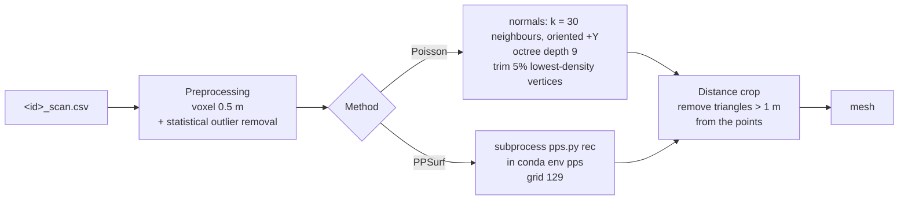
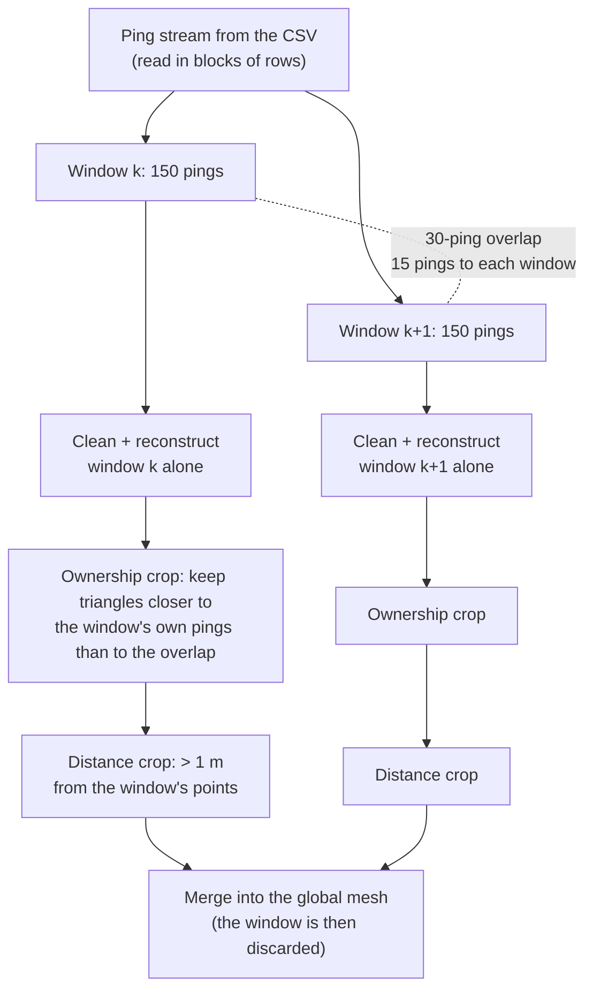
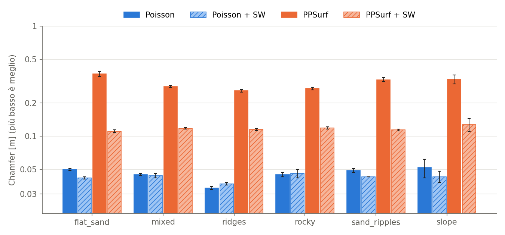
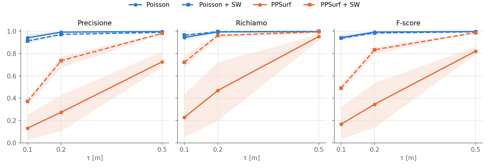
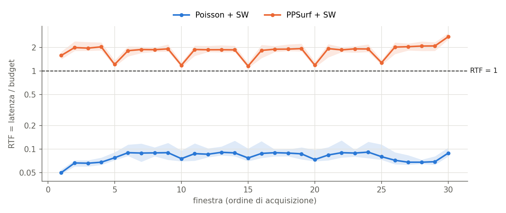

# Seabed 3D reconstruction from multibeam sonar

This repository reconstructs a 3D mesh of the seabed from multibeam sonar point
clouds and evaluates the result against a known ground truth.

It compares two methods on synthetic terrains:

- **Poisson**: classical Poisson Surface Reconstruction (Open3D);
- **PPSurf**: a neural, patch-based method, used with its pretrained weights.

Each method runs in two modes:

- **full scan**: the whole point cloud of a terrain is reconstructed at once;
- **sliding window (SW)**: the scan is read in windows of pings, as if the
  data were arriving from the sonar during the survey.

Installation is described in [SETUP.md](SETUP.md). Diagnostic experiments,
parameter choices and discarded methods are in [ANALYSIS.md](ANALYSIS.md).

## Table of contents

1. [Repository layout](#repository-layout)
2. [Method](#method)
   - [Synthetic data](#synthetic-data)
   - [Reconstruction pipeline](#reconstruction-pipeline)
   - [Sliding window](#sliding-window)
   - [Real-time metrics](#real-time-metrics)
   - [Evaluation metrics](#evaluation-metrics)
   - [Run output](#run-output)
3. [Usage](#usage)
4. [Results](#results)
   - [Setup](#setup)
   - [Accuracy](#accuracy)
   - [Timing](#timing)
   - [Discussion](#discussion)
5. [Next steps](#next-steps)
6. [Technical notes](#technical-notes)

## Repository layout

```
.
├── evaluate.py                     # ENTRY POINT: reconstructs and evaluates the synthetic terrains
├── config/config.yaml              # preprocessing, sliding window, method and evaluation parameters
├── scripts/
│   ├── poisson.py                  # Poisson reconstruction (Open3D), density trim, mesh cleanup
│   └── ppsurf.py                   # runs PPSurf as a subprocess in the conda env "pps"
├── utils/
│   ├── pipeline.py                 # config loading, preprocessing, method executors, sliding window, crop
│   ├── mesh.py                     # CSV loading, point cloud cleanup, normals, top_surface (GT seabed)
│   ├── run_info.py                 # environment, git state, terminal log, RAM/VRAM monitor for each run
│   ├── generate_seabed_heightmaps.py  # generates the synthetic seabeds (6 families, pipes and pillars)
│   ├── simulate_multibeam_scans.py    # simulates the multibeam scan -> <id>_scan.csv + <id>_ground_truth.obj
│   ├── mesh_comparison.py          # (legacy) comparison plots on the Unity dataset Terrain_unity
│   └── comparison_ground_truth_obj_and_unity_csv.py  # (legacy) alignment of Unity CSV and OBJ
├── visualization/
│   ├── plot_chamfer.py             # Chamfer per seabed family, 4 configurations -> imgs/
│   ├── plot_tau.py                 # precision, recall, F-score as a function of τ -> imgs/
│   ├── plot_rtf.py                 # real-time factor per window, Poisson + SW vs PPSurf + SW -> imgs/
│   ├── screenshot_run.py           # screenshots of all meshes of one or more runs
│   ├── visualize_mesh.py           # interactive Open3D viewer for a .ply mesh
│   └── orbite_mesh.py              # orbit video around a mesh
├── benchmark/                      # diagnostic and timing experiments (see ANALYSIS.md)
│   └── benchmark_output/           # their results (CSV, meshes; ignored by git)
├── imgs/                           # plots used in this README
├── data/
│   ├── data_analisys.py            # exploratory analysis of a point cloud CSV
│   ├── sonar/                      # real Omniscan 3D data and Unity scans
│   ├── real/                       # other real data (Malamocco)
│   └── synthetic/                  # synthetic terrains: train/ val/ test/ test+val/
├── output/                         # everything produced by runs (ignored by git)
│   └── evaluation/<date_time>_<split>[_sw]/  # one folder per run
├── neural_methods/ppsurf/          # cloned PPSurf repository (not tracked)
├── env_setup.sh                    # "source env_setup.sh": WSLg fix + activates the conda env
├── requirements.txt                # dependencies of the "ricostruzione3d" environment
├── ANALYSIS.md                     # experiments and parameter choices (Italian)
├── README_old.md                   # historical README (earlier project phases)
└── SETUP.md                        # installation on a new machine
```

## Method

### Synthetic data

The terrains are generated in two steps.

1. `utils/generate_seabed_heightmaps.py` generates heightmaps of 100 × 100 m in
   **6 families**: `flat_sand`, `sand_ripples`, `ridges`, `rocky`, `slope` and
   `mixed`. With `--with-structures` it adds pipes and pillars. The split is
   done per terrain, never per scan; the current dataset has 17 terrains per
   family: train 72, val 18, test 12.
2. `utils/simulate_multibeam_scans.py` simulates the sonar. The platform follows
   a lawn-mower path; at each ping a fan of beams is ray-cast on the terrain
   mesh, with range noise, dropout and outliers. The sensor parameters are
   set as constants at the top of the script. The ping rate (6 pings/s) and
   the fan aperture (120°) are estimated from the real dataset
   `OS3D_Max_Range_Test.csv`, which has ~276 points per ping; the simulator
   uses 200 beams per ping. For each terrain it writes:
   - `<id>_scan.csv`: the point cloud, columns
     `x,y,z,intensity,ping_number,elapsed_s` (Y is vertical, `elapsed_s` is the
     time since the start of the scan);
   - `<id>_ground_truth.obj`: the true mesh, closed (seabed + walls + bottom);
   - `<id>_scan.json`: scan parameters and applied offsets.

All results in this README use `data/synthetic/test+val/`. This folder is the
union of `val/` and `test/`: 30 terrains, 5 per family (`*_012`–`*_014` from
val, `*_015`–`*_016` from test). It is created by hand; the command is in
[SETUP.md](SETUP.md#4-synthetic-data).

### Reconstruction pipeline

`utils/pipeline.py` runs the same steps for every method:



| Step | Config section | What it does |
|---|---|---|
| Preprocessing | `preprocessing` | Voxel downsampling at 0.5 m (`voxel_size`), then statistical outlier removal with 20 neighbours (`nb_neighbors`) and 2 standard deviations (`std_ratio`). Same for all methods. |
| Poisson | `poisson` (`scripts/poisson.py`) | Normals from the 30 nearest neighbours, oriented upwards (+Y). Octree depth 9 (`profondita`). Vertices in the lowest 5% of density are removed (`rimuovi_bassa_densita`): that is where Poisson invents surface far from the data. Then degenerate and duplicated triangles are removed. |
| PPSurf | `ppsurf` (`scripts/ppsurf.py`) | The point cloud is written to disk and reconstructed by `neural_methods/ppsurf/pps.py` in the conda environment `pps` (`conda_env`). Marching-cubes grid 129 (`gen_resolution_global`). The mesh is read back in the input coordinates (metres). The subprocess is killed after `timeout_s` (1200 s). |
| Distance crop | `postprocessing` | Triangles whose centroid is more than 1 m (`distanza_max_punti`) from the nearest input point are removed. |

The distance crop is applied in both modes, so that full-scan and SW results
stay comparable. Its threshold must stay above τ (0.5 m); with a threshold
≤ τ, precision would be guaranteed by the crop itself.

### Sliding window

The sliding window (config section `sliding_window`) simulates online use.
The CSV is read in blocks of rows (`righe_per_blocco`), as if it were
arriving from the sonar. The points are grouped into windows of **150 pings**
(`ping_per_finestra`, ~25 m of track) that overlap by **30 pings**
(`ping_sovrapposizione`). With 300-ping windows (~50 m), PPSurf left many
holes on smooth seabeds; see
[ANALYSIS.md](ANALYSIS.md#dimensione-della-finestra-e-buchi-di-ppsurf).



- Each window is cleaned and reconstructed on its own. Only the current window
  is kept in memory.
- **Ownership crop.** The overlap is split in half between two consecutive
  windows. Of each window's mesh, only the triangles closer to the window's own
  pings than to the overlap pings are kept. The first window keeps its start
  and the last window keeps everything that remains.
- **Distance crop.** The mesh is then cropped at 1 m from the points of that
  window, and merged with the others.
- A window with fewer than 100 points after cleaning is skipped.

The distance crop is essential for Poisson. A window is a strip open on all
sides (~26 m wide), and Poisson closes it with a **dome in the water**, about
6 m above the seabed. The 5% density trim does not remove it: on
`flat_sand_012`, without the crop, 36% of the surface was spurious (F-score
0.78, p95 reconstruction→seabed 12.5 m). With the 1 m crop, Poisson + SW is
back at the level of Poisson on the full scan. Test values at τ = 0.5 m, with
the 300-ping windows used at the time:

| Terrain | Mode | Chamfer | Precision | F-score | p95 rec→GT |
|---|---|---|---|---|---|
| flat_sand_012 | full | 0.050 m | 0.997 | 0.999 | 0.11 m |
| flat_sand_012 | SW, no crop | 1.133 m | 0.642 | 0.782 | 12.4 m |
| flat_sand_012 | SW, 1 m crop | 0.047 m | 0.988 | 0.994 | 0.15 m |
| rocky_012 | full | 0.047 m | 1.000 | 1.000 | 0.12 m |
| rocky_012 | SW, no crop | 0.151 m | 0.905 | 0.950 | 1.19 m |
| rocky_012 | SW, 1 m crop | 0.053 m | 0.986 | 0.993 | 0.22 m |

The sliding window is enabled with `--sliding_window on` (or
`sliding_window.abilitato: true` in the config). Meshes, distance files and
the run folder get the suffix `_sw`.

### Real-time metrics

With the sliding window, every window gets one row in `finestre.csv`
("windows"):

| Column | Definition |
|---|---|
| `latenza_s` | Latency: from the moment the window is complete (its last ping arrives) to the moment its mesh is merged. Includes filtering, cleaning, reconstruction (with method start-up) and cropping. |
| `tempo_metodo_s` | Reconstruction only, as measured by the method. |
| `acquisizione_s` | Acquisition time: duration of the window, from first to last ping (`elapsed_s` column of the scan). |
| `budget_s` | Time between the completion of the previous window and of this one, i.e. the time available before the next window arrives. With 150 pings and a 30-ping overlap, 120 new pings arrive per window, ~20 s at 6 pings/s. For the first window it equals `acquisizione_s`. |
| `rtf` | Real-time factor = `latenza_s / budget_s`. |

With **RTF < 1** the method keeps up with the sonar; with RTF > 1 windows pile
up. For each terrain, `metriche_per_terreno.csv` also reports
`latenza_mediana_s` (median latency), `latenza_max_s` (maximum latency),
`rtf_mediano`, `rtf_max` and `finestre_in_tempo` (fraction of windows with
RTF ≤ 1).

### Evaluation metrics

For each terrain and method, `evaluate.py` samples **100 000 points** uniformly
on the reconstructed mesh and as many on the ground-truth seabed
(`evaluation.n_campioni`). It then computes the exact point-to-surface
distance in both directions.

| Metric | CSV column | Definition | What it measures |
|---|---|---|---|
| Precision | `precisione` | fraction of reconstruction points within τ of the seabed | spurious surface (double shell, "tents" at the borders) |
| Recall | `richiamo` | fraction of seabed points within τ of the reconstruction | holes |
| F-score | `fscore` | harmonic mean of precision and recall | summary at threshold τ |
| Chamfer | `chamfer` | (mean reconstruction→seabed + mean seabed→reconstruction) / 2, in metres | mean error, no threshold |
| Median, IQR, p95 | `rec2gt_*`, `gt2rec_*` | per direction: `rec2gt` = reconstruction→seabed, `gt2rec` = seabed→reconstruction | error distribution: the median is the typical error, the IQR (p75 − p25) the spread, the p95 the tail |

The default threshold is τ = 0.5 m (`evaluation.tau`), equal to the voxel size
of the preprocessing.

The metrics are computed against the **seabed only**, not against the whole
ground truth. The ground truth is a closed block: walls and bottom only close
it and the sonar never sees them. `top_surface` (`utils/mesh.py`) separates
the seabed from them. Against the whole block, spurious surface running down
the walls would count as correct; against the seabed alone it is penalised.

### Run output

Each call of `evaluate.py` creates a new folder
`output/evaluation/<date_time>_<split>[_sw]/` (for example
`2026-11-13_01-11-45_test+val_sw/`) containing everything about that run and
nothing else:

| File | Content |
|---|---|
| `config.txt` | the command, the effective config (with command-line overrides applied), machine (CPU, GPU, versions) and git commit |
| `git_diff.patch` | only if there were uncommitted changes: their diff |
| `log.txt` | full terminal output, including subprocesses |
| `metriche_per_terreno.csv` | one row per (terrain, method): metrics, time, RAM and VRAM peak (`ram_picco_mb`, `vram_picco_mb`), errors (`errore`) |
| `metriche_per_famiglia.csv` | means per (family, method), with standard deviation across terrains for Chamfer, precision, recall and F-score (`*_std`) |
| `finestre.csv` | SW only: one row per window (see [Real-time metrics](#real-time-metrics)) |
| `meshes/<id>_<method>[_sw].ply` | reconstructed meshes |
| `distanze/<id>_<method>[_sw]_{rec2gt,gt2rec}.npy` | raw distance vectors ("distances"), float32, 100 000 values each |
| `metriche_tau.csv`, `metriche_tau_per_famiglia.csv` | written by `--ricalcola` (see [Usage](#usage)): metrics at several τ, per terrain and per family (mean ± std) |
| `screenshots/` | written by `visualization/screenshot_run.py` |

## Usage

Run everything from the repository root, with the `ricostruzione3d`
environment active:

```bash
source env_setup.sh
```

**Full evaluation** on `test+val` (30 terrains). The results below were
produced with one run per configuration:

```bash
python evaluate.py --methods poisson --split test+val
python evaluate.py --methods ppsurf  --split test+val --set ppsurf.rec_batch_size=50000
python evaluate.py --methods poisson --split test+val --sliding_window on
python evaluate.py --methods ppsurf  --split test+val --sliding_window on --set ppsurf.rec_batch_size=50000
```

| Option | Meaning |
|---|---|
| `--split {train,val,test,test+val}` | data split; default from `evaluation.split` (`test+val`) |
| `--methods poisson ppsurf` | methods to run, in sequence on each terrain; default both |
| `--limit N` | the first N terrains **of each family** (alphabetical order), not N in total |
| `--sliding_window {on,off}` | overrides `sliding_window.abilitato` |
| `--set SECTION.KEY=VALUE ...` | overrides any config value for this run, e.g. `--set ppsurf.gen_refine_iter=5 poisson.profondita=8`; repeatable |
| `--tau T` | threshold in metres; several values only with `--ricalcola` |
| `--ricalcola RUN_FOLDER` | "recompute": no reconstruction, recomputes Chamfer, precision, recall and F-score for each `--tau` from the raw distances of an existing run |

Without arguments, `evaluate.py` uses the defaults of the `evaluation` section
of the config (`test+val`, all terrains, Poisson and PPSurf, full scan).

**Quick check**, one terrain per family:

```bash
python evaluate.py --split val --limit 1 --methods poisson
```

**Metrics at other thresholds**, without reconstructing:

```bash
python evaluate.py --ricalcola output/evaluation/<run> --tau 0.1 0.2 0.5
```

**Screenshots** of every mesh of one or more runs, with the same camera for
the same terrain across runs (written to `<run>/screenshots/`):

```bash
python visualization/screenshot_run.py output/evaluation/<run1> output/evaluation/<run2>
python visualization/screenshot_run.py --ground_truth --dati data/synthetic/test+val   # ground truth only
```

**Interactive viewer** for one mesh (the path is set in `PERCORSO_MESH` at the
top of the file):

```bash
python visualization/visualize_mesh.py
```

## Results

### Setup

- **Data**: `test+val`, 30 terrains, 5 per family.
- **Sliding window**: windows of 150 pings with a 30-ping overlap (~25 m of
  track, ~20 s of budget per window).
- **Crop**: triangles more than 1 m from the points are removed, in both
  modes.
- **PPSurf**: default config (grid 129, test-time augmentation and refinement
  iterations 3/3) with `ppsurf.rec_batch_size=50000`, which changes only speed
  and memory.
- **Hardware**: NVIDIA GTX TITAN X, 12 GB.
- **Thresholds**: τ = 0.1, 0.2 and 0.5 m; the values at 0.1 and 0.2 are
  recomputed with `--ricalcola`.
- **Full tables**: precision, recall and F-score at each τ, mean ± std per
  family, are in `metriche_tau_per_famiglia.csv` of the four runs.

| Configuration | Run folder |
|---|---|
| Poisson | `output/evaluation/2026-11-13_00-17-36_test+val` |
| PPSurf | `output/evaluation/2026-11-13_00-21-04_test+val` |
| Poisson + SW | `output/evaluation/2026-11-13_00-44-19_test+val_sw` |
| PPSurf + SW | `output/evaluation/2026-11-13_01-11-45_test+val_sw` |

### Accuracy



Chamfer distance per family, mean ± std over the 5 terrains, log scale.

F-score per configuration (range across families):

| | F τ=0.1 | F τ=0.2 | F τ=0.5 |
|---|---|---|---|
| Poisson | 0.93–0.97 | 0.99–1.00 | 0.995–0.999 |
| Poisson + SW | 0.92–0.95 | 0.98–0.99 | 0.993–0.995 |
| PPSurf | 0.04–0.32 | 0.14–0.54 | 0.79–0.86 |
| PPSurf + SW | 0.46–0.53 | 0.80–0.86 | 0.985–0.992 |



Line = mean across families, band = min–max across families. PPSurf + SW
reaches Poisson at τ = 0.5; below that, its limit is precision (the double
shell), not recall.

Both plots are generated with:

```bash
python visualization/plot_chamfer.py \
    --poisson    output/evaluation/2026-11-13_00-17-36_test+val \
    --ppsurf     output/evaluation/2026-11-13_00-21-04_test+val \
    --poisson_sw output/evaluation/2026-11-13_00-44-19_test+val_sw \
    --ppsurf_sw  output/evaluation/2026-11-13_01-11-45_test+val_sw
python visualization/plot_tau.py    # same four arguments
```

`plot_tau.py` uses the τ values present in `metriche_tau_per_famiglia.csv`;
run `--ricalcola` with more values for a finer curve.

### Timing

Without SW: reconstruction time per terrain. With SW: budget ~20 s per window
(120 new pings at 6 pings/s), RTF = latency / budget. Ranges go from the best
to the worst family.

| Method | Time per terrain | Median latency | Max latency | Median RTF | Max RTF | Windows in time | VRAM |
|---|---|---|---|---|---|---|---|
| Poisson | 2.2–4.3 s | – | – | – | – | – | – |
| PPSurf | 38–43 s | – | – | – | – | – | 8.7 GB |
| Poisson + SW | 42–47 s | 1.6–1.7 s | 2.5–2.7 s | 0.08–0.09 | 0.12–0.14 | 100% | – |
| PPSurf + SW | 950–1140 s | 36–41 s | 47–57 s | 1.8–2.1 | 2.6–3.2 | 0% | 8.6 GB |

PPSurf's VRAM is high because of `rec_batch_size=50000`; with 10000 (the
config default, sized for a 4 GB GPU) it drops to ~1.9 GB.



RTF of each window along the track, log scale. Line = median across the 30
terrains, band = 10th–90th percentile. Poisson stays an order of magnitude
below RTF = 1; PPSurf is above it in every window. Every fifth PPSurf window is
faster (latency ~24 s instead of ~38 s); the period matches 5 × 120 new pings,
so these are probably the windows that contain a turn of the survey path. This
has not been verified. Generated with:

```bash
python visualization/plot_rtf.py \
    --poisson_sw output/evaluation/2026-11-13_00-44-19_test+val_sw \
    --ppsurf_sw  output/evaluation/2026-11-13_01-11-45_test+val_sw
```

Why the windows are 150 pings and not 300: see
[ANALYSIS.md](ANALYSIS.md#dimensione-della-finestra-e-buchi-di-ppsurf).

### Discussion

**Poisson**
- The sliding window costs no accuracy: Chamfer 0.04–0.05 m and F τ=0.5 ≥ 0.99
  in both modes, std ≤ 0.01.
- With SW the mesh is finer, because the octree depth is relative to the
  window: recall at τ=0.1 rises (0.92–0.97 → 0.95–0.98) and Chamfer improves
  on 4 families out of 6.
- Precision drops by 1–4% at τ ≤ 0.2: some spurious surface remains within
  1 m, i.e. remnants of the dome near the points and double layers where
  adjacent survey lines overlap.
- It is comfortably real-time (RTF 0.08, all windows in time): **ready for
  online use**.

**PPSurf**
- The sliding window improves every metric on every family: Chamfer from
  0.26–0.37 to 0.11–0.13 m (−55/−70%), F τ=0.5 from 0.79–0.86 to
  0.985–0.992, F τ=0.2 from 0.14–0.54 to 0.80–0.86.
- At τ=0.5 it is almost on par with Poisson (F 0.985–0.992 against
  0.993–0.995).
- **Below 20 cm it stays far from Poisson**: F τ=0.1 0.46–0.53 against
  0.92–0.95. Recall is good (~0.97 at τ=0.2), precision is not (~0.75 at
  τ=0.2, ~0.38 at τ=0.1): this is the double shell, two layers ~10–15 cm
  above and below the seabed.
- **It is not real-time**, not even on the TITAN X: median RTF ~1.9, no
  window in time. Each call costs ~35–40 s regardless of the window size
  (grid and test-time augmentation set the cost), and smaller windows halve
  the budget.

## Next steps

1. **PPSurf + SW, precision at small τ**: keep a single layer of the shell
   (the middle layer, as in `benchmark/strato_singolo_ppsurf.py`).
2. **PPSurf + SW, time**: a coarser grid on the small windows (97: cell
   ~0.26 m), less test-time augmentation, or several windows per call with the
   model loaded once.
3. **Poisson + SW**: deduplicate the areas where adjacent survey lines
   overlap.

## Technical notes

- **Distance crop in SW mode.** In the sliding window, the 1 m crop is
  measured from the window's points after voxel downsampling but **before**
  outlier removal; in full-scan mode it uses the cleaned point cloud. The
  difference is small at a 1 m threshold, but the two modes are not strictly
  identical.
- **Omniscan 3D format** (real data, exported from SonarView): CSV with
  `easting/northing`, `altitude`, `power (dB)`, `classification` and
  `ping number`. The sensor has no RGB. Class 2 is probably the water column.
  The filters for real data (classes, altitude, excluded areas) are still
  supported by `utils/pipeline.py` but are no longer in the config. To use
  them, add them under `preprocessing`: `escludi_classi` (classes to exclude),
  `altitude_min`, `altitude_max` (on the vertical Y axis), and `escludi_zona_x`
  with `escludi_zona_z` (a rectangle to exclude, `[min, max]` on X and Z; both
  must be set).
- **PPSurf memory.** The marching-cubes stage dominates VRAM, regardless of
  the number of input points. `gen_resolution_global` and `rec_batch_size` set
  it; see [SETUP.md](SETUP.md#6-configuration-for-low-vram).
